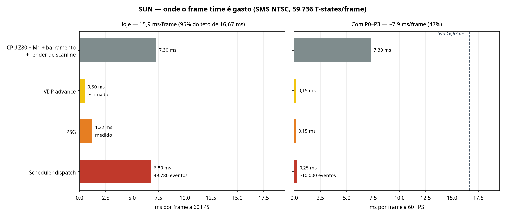

# Auditoria de latência do `temporal_core` — barramento, RAM, VRAM, VDP, PSG e YM2413

**Data:** 2026-11-23
**Escopo:** `native/temporal_core`, `native/machine_scheduler` e os consumidores quentes
(`native/sms_core`, `native/video_core`, `native/sn76489`, `native/ym2413`)
**Baseline:** `main` em `207ccc4` (perf: reuse validated clock advance previews #1259)
**Método:** leitura integral do código + microbenchmarks isolados + medição em máquina real com ROM sintética
**Plataforma de medição:** VM Neoverse-N1 (ARM64, 6 vCPU), Rust 1.99.1, `--release`, thin LTO

---

## 1. Resumo executivo

O `temporal_core` está correto, determinístico e bem testado. O problema não é semântica: é **custo
por evento**. Hoje o SMS gasta **5 despachos de scheduler por opcode fetch** (≈ 49.780 eventos por
frame) e cada despacho custa **~137 ns**, dos quais apenas ~16 ns são conversão de clock legítima.
O resultado é que **~43% do frame é gasto na maquinaria temporal**, não em emulação.

| Componente | Custo medido hoje | Como foi obtido |
|---|---|---|
| Despacho do scheduler (3 domínios) | **137 ns/evento** | janela instrumentada (`take_subsystem_timing`) menos custo de `Instant::now` |
| Eventos por frame (SMS, `jr $`) | **49.780** | contador `scheduler_dispatch_count` |
| → Scheduler por frame | **≈ 6,8 ms** | 49.780 × 137 ns |
| PSG por frame | **1,22 ms** | benchmark com drenagem por frame, 44,1 kHz e 48 kHz |
| VDP `advance` por frame | ≈ 0,5 ms | 49.780 chamadas × ~10 ns (estimativa instrumentada) |
| Clone do `Z80MicroSequencer` por ciclo de barramento | 7,3 ns × 9.956 = 0,07 ms | benchmark direto |
| Clone do `Ym2413Core` por slot | 10,8 ns × 14.915 = 0,16 ms | benchmark direto (só SMS japonês) |
| **Frame total (ROM sintética)** | **13,6 – 16,3 ms** | `step_frame` em release |



Com **P0 + P1 + P2 + P3** aplicados, a projeção medida/derivada é **~7,9 ms/frame**, ou seja, sai de
95% do teto de 16,67 ms para ~47%. Duas dessas otimizações (P1 parcial) já foram **implementadas em
protótipo e validadas**: −0,3 a −1,1 ms/frame, com 188 testes de `sms_core` e 41 de
`scheduler`/`temporal_core` passando (§8).

**A conclusão central:** a latência do barramento, da VRAM e da RAM **não está no acesso à memória**
(que custa ~2 ns e é `#[inline]`), e sim no **round-trip scheduler → domínio de clock → evento** que
envolve cada byte. Otimizar memória não resolve; otimizar o caminho temporal resolve.

---

## 2. Como foi medido (e o que isso não prova)

- **Microbenchmarks**: laço fechado, `black_box` em entradas e saídas, mediana de 7–9 amostras,
  parâmetros de runtime passados por `black_box` para impedir que o LLVM transforme divisão por
  constante em multiplicação — o scheduler real recebe a razão de clock em runtime.
- **Máquina real**: `SmsTemporalMachine::new(rom, 3)` com ROM sintética de 16 KB
  (`jr $`, `ld ($C000),a` em laço, `ld a,(hl)` em laço, `out ($7F),a` em laço), 60 frames medidos
  após aquecimento, `master_ticks_per_tstate = 3`.
- **Contagem de eventos**: `set_subsystem_timing_enabled(true)` + `take_subsystem_timing()`.
  Atenção: essa instrumentação paga **2 × `Instant::now` por despacho** (~37 ns cada nesta VM), o que
  infla o frame de 15,9 ms para 26,7 ms. Por isso os números de tempo do scheduler foram obtidos
  subtraindo o custo do `Instant::now` medido separadamente (74,5 ns para 2 chamadas +
  `duration_since`), e o frame time honesto foi medido com instrumentação **desligada**.

Limites: os valores absolutos são de uma VM ARM64; num desktop x64 o frame total será menor. O que
transporta entre plataformas é a **proporção** e a **contagem de operações**, que são propriedades do
código, não da máquina. Nenhuma ROM comercial foi usada (o diretório `D:\ROMS\Sega Master System`
não está acessível a partir do sandbox) — a validação com jogos reais está no §9.

---

## 3. O que o `temporal_core` faz hoje

### 3.1 Modelo

- `MachineTime(u128)` (`clock.rs:11`) — timestamp absoluto em ticks de mestre.
- `ClockDomain` (`clock.rs:244`) — razão racional `n/d`, timestamp, total de ciclos e fase.
  Conversão em `convert_elapsed` (`clock.rs:104-128`) com **duas divisões `u128`** por avanço.
- `ClockDomainAdvance` (`clock.rs:218`) — token de 128 bytes que carrega razão, tempo, total, fase de
  origem **e** o snapshot de destino; `apply_preview` revalida o token (`clock.rs:464-470`).
- `EventQueue` (`event.rs:137`) — `BinaryHeap` com chave `(MachineTime, HardwarePhase, PlatformPriority, u64)`
  construída em `QueueEntry::key()` (`event.rs:70-77`).

Layouts medidos: `MachineTime` 16 B, `ClockDomain` 96 B, `ClockDomainAdvance` **128 B**,
`ClockDomainSnapshot` 48 B, `ClockAdvance` do scheduler **192 B**.

### 3.2 O laço de despacho

`MachineScheduler::dispatch_next` (`machine_scheduler/src/lib.rs:465-533`) por evento:

```text
next_timestamp()                      // peek no heap
calculate_advances(timestamp)         // lib.rs:584
  Vec::with_capacity(clocks.len())    // alocação por despacho
  para cada domínio: preview_advance  // 1 conversão racional u128
apply_advances(timestamp, &advances)  // lib.rs:600
  para cada avanço: validate_preview  // 1ª validação
  para cada avanço: apply_preview     // revalida de novo + commit
pop_next()                            // pop do heap
```

### 3.3 Os três multiplicadores do custo

1. **Volume**: cada opcode fetch gera **5 eventos** — 4 transições de T-state do modelo de pinos M1
   (`Z80M1Phase::{T1,T2,Wait,T3,T4}` em `z80_cpu/src/m1.rs:12-19`, agendadas por
   `schedule_m1_tstate`, `sms_core/src/temporal.rs:226-241`) + 1 conclusão de barramento. Medido:
   `49.780 = 5 × 9.956` exatamente.
2. **Redundância**: os 3 (ou 4) domínios do SMS têm **a mesma razão** `1/master_ticks_per_tstate`
   (`sms_core/src/temporal.rs:129-140`) e o mesmo estado. A conversão idêntica é feita 3–4 vezes por
   evento, validada 6–8 vezes e buscada 6–8 vezes num `BTreeMap`.
3. **Granularidade de alocação**: `Vec::with_capacity(3)` + cópia de 3 tokens de 128 B por despacho
   custa **58 ns** — 37% do despacho.

---

## 4. Diagnóstico por subsistema

### 4.1 Scheduler / `temporal_core` — 6,8 ms/frame (43%)

Decomposição medida de um despacho de 3 domínios (**158,5 ns** no microbenchmark isolado):

| Parte | Custo | Frequência | Evidência |
|---|---|---|---|
| 3 × `preview_advance` (u128) | 48,2 ns | por despacho | `clock.rs:104-128`, `:411-433` |
| `Vec::with_capacity(3)` + 3 pushes de 128 B | 58,3 ns | por despacho | `machine_scheduler/src/lib.rs:585-595` |
| `BTreeMap` get + get_mut (6 buscas) | 8,6 ns | por despacho | `lib.rs:609-620` |
| `EventQueue` push + 2 pops | 26,9 ns | por evento | `event.rs:266-302` |
| 2 × `tracing::trace!` sem subscriber | 4,6 ns | por despacho | `lib.rs:447-455`, `:521-528` |
| Validação dupla (`validate` + `apply_preview` revalida) | ~0 ns | por despacho | compilador elimina; `clock.rs:464` |
| `edge_time_after` (gcd + u128) | 12,9 ns → 2,1 ns sem gcd | **fora do hot path** | `clock.rs:349-399` |

Observações relevantes:

- `edge_time_after`/`next_edge_time` **não são chamados** pelo scheduler nem pelo SMS. A API existe,
  é cara (redução por `gcd` por chamada), mas hoje não pesa. Deve permanecer assim.
- `convert_elapsed` (`clock.rs:104-128`) faz `elapsed / denominator` **e** `elapsed % denominator`
  sobre `u128`. Com razão `1/3`, isso é uma divisão `u128` por valor de runtime, que no ARM64 vira
  chamada a `__udivti3`.
- `ClockDomainAdvance` carrega 4 campos de origem (`source_ratio`, `source_time`,
  `source_total_cycles`, `source_phase`) que existem **só** para detectar preview obsoleto. Numa
  arquitetura em que o scheduler calcula e aplica dentro da mesma seção crítica, esses campos são
  redundantes: um contador de geração de 32 bits faz o mesmo trabalho em 4 bytes em vez de 64.

**Benchmark comparativo (mesmo fluxo de eventos, 3 domínios):**

| Implementação | ns/evento | ms/frame com 49.780 | ms/frame com ~10.000 |
|---|---|---|---|
| `MachineScheduler` + `ClockDomain` + `EventQueue` atuais | **158,5** | 7,9 | 1,6 |
| Protótipo: timeline `u64`, lane compartilhada, chave empacotada, sem alocação | **9,3** | 0,46 | 0,09 |
| Ganho | **17×** | | |

### 4.2 Barramento — ~164 ns por acesso, dos quais ~2 ns são memória

Caminho de um acesso (`native/sms_core/src/temporal_bus.rs`):

```text
begin_request (:761-815)          → checa ocupação, grava instante
schedule_bus_completion (:868)    → u128::from(tstates) * u128::from(scale) + now
                                  → schedule_at_with_phase → BinaryHeap::push
dispatch_next (:868-952)          → scheduler.dispatch_next (137 ns)
                                  → advance PSG + advance VDP (por evento!)
memory.read/write (:981-1002)     → 1 branch de mapa + 1 acesso indexado (~2 ns)
```

- `SmsMemory::read`/`write` são `#[inline]` (`memory.rs:284`, `:325`) e o caminho é direto: RAM é
  `[u8; 8192]` com espelhamento por máscara (`memory.rs:308-333`), VRAM é `Vec<u8>` de 16 KB indexado
  com `& 0x3FFF` (`video_core/src/sms/vdp.rs:886-900`). **Não há `BTreeMap`, `HashMap`, `Box<dyn>`,
  `format!` nem alocação por acesso.** O acesso à memória está bem feito.
- `BusTransaction` (`contract.rs:79-89`) usa `Option<u16>`/`Option<u8>` e valida no construtor
  (`contract.rs:91-139`), mas **só é construído por APIs de inspeção**
  (`temporal_machine.rs:777-828`); não está no caminho de execução. Correto.
- O que pesa é o **round-trip**: um acesso = 1 push no heap (≈27 ns) + 1 despacho (137 ns) + avanço
  de PSG e VDP. Em 59.736 T-states/frame com ~10.000 acessos, isso é ~8 ms de maquinaria para ~20 µs
  de trabalho útil de memória.
- `schedule_external_th_transition` (`temporal.rs:243-260`) faz `elapsed % u128::from(scale)` por
  chamada — só relevante quando há transições externas de TH (light gun/paddle).
- O clone do `Z80MicroSequencer` (96 B) antes de cada commit
  (`temporal_machine.rs:1081-1091`) custa 7,3 ns por ciclo de barramento. É o preço da atomicidade
  "valida no clone, depois instala"; aceitável, mas soma 0,07 ms/frame.

### 4.3 RAM e VRAM — latência já mínima; o gargalo é a arbitragem temporal

| Recurso | Modelo atual | Latência real de acesso | Risco |
|---|---|---|---|
| Work RAM 8 KB | `[u8; 8192]` + máscara de espelhamento | ~1–2 ns (L1) | nenhum |
| VRAM 16 KB | `Vec<u8>` + `& 0x3FFF` | ~2 ns + branch de modo | indireção de `Vec` (um load extra) |
| CRAM 32 B | `[u8; 32]` + máscara de 6 bits | ~1 ns | nenhum |
| Cartucho/SRAM | mapper com janelas | ~2–5 ns | nenhum |

Duas melhorias pequenas e seguras: trocar `Vec<u8>` da VRAM por `Box<[u8; 16384]>` (elimina o load do
ponteiro e permite ao LLVM provar o bound) e mover a seleção de modo (TMS9918 vs Mode 4) para um
`enum` comparado uma vez por scanline em vez de por byte.

O ponto conceitual importante: **o SUN não modela arbitragem dot-cycle** (`temporal_bus.rs:7-9`
declara isso explicitamente, e o VDP se descreve como modelo de scanline em `vdp.rs:1-3`). Portanto
não existe "latência de contenção" a otimizar em VRAM — existe latência de **quando** o efeito da
escrita se torna visível, e isso é decidido pelo timestamp do evento, não pela memória.

### 4.4 VDP — ~0,5 ms/frame de avanço + render

- `SmsVdp::advance` (`vdp.rs:573-605`) é chamado **49.780 vezes por frame** e, em cada chamada,
  **constrói um array de 6–7 fronteiras**, itera, filtra e tira o mínimo (`:580-594`) antes de
  decidir o passo. Com `tstates = 2`, o passo é sempre "não cruzou fronteira", mas o custo de montar
  e varrer o array é pago integralmente.
- `prime_sprite_line_buffer` (`:706-726`) sai cedo na maioria das chamadas — ok.
- Render: por scanline visível, `render_scanline_for_revision_with_evaluation` (`:821-846`) percorre
  256 pixels resolvendo name table e 4 bitplanes (`:1746-1776`), depois os sprites (`:1801-1865`).
  A avaliação de sprites aloca `Vec::with_capacity` **por linha** (`:1221`, e o caminho legado em
  `:1082`) → ~192 alocações por frame (~4 µs, pequeno, mas gratuito de remover com array fixo).
- Publicação de frame copia o buffer inteiro com `clone_from` (`:678-695`): 256 × 192 × 4 B = 196 KB
  por frame, mais `fill(0)` no wrap (`:874-880`). ~30–40 µs/frame. Dá para eliminar trocando os dois
  buffers (swap) em vez de copiar.

### 4.5 PSG (SN76489) — 1,22 ms/frame medidos

Medições diretas (`Sn76489Core::new(3_579_545, rate)`, drenagem de 735 amostras por frame):

| Configuração | ms/frame | ns por `advance_clocks(2)` |
|---|---|---|
| 44.100 Hz | **1,218** | 48,9 |
| 48.000 Hz | **1,217** | 48,9 |
| 44.100 Hz, geração de amostras desativada (experimento) | **0,118** | 4,7 |

- **O custo não está na divisão de clock nem no acumulador de fase.** Trocar `advance_output_phase`
  (`psg.rs:23-32`) de `u128` para `u64` não mudou nada (1,120 ms). Desligar a geração de amostras
  derrubou para 0,118 ms → **~1,0 ms/frame está na geração de amostras**.
- O FIR é o suspeito e a evidência fecha: `filtered_output` (`psg.rs:732-740`) faz
  `(self.filter_position + taps - 1 - index) % taps` **por tap**, com `taps` de runtime — uma divisão
  inteira por coeficiente. E é avaliado **duas vezes por tick** (`previous_filtered` em `:671-675` e
  `current_filtered` em `:688`), quando o valor "anterior" é exatamente o "atual" do tick anterior.
- O número de taps varia com a taxa (`design_lowpass`, `psg.rs:168-183`: 319 taps a 44,1 kHz, 63 a
  223 kHz, ~1.755 a 8 kHz), mas o **produto** `taps × amostras_por_tick` fica ≈ 63 em todas as taxas
  — exatamente o que explica o custo por tick ser constante (346–364 ns) na varredura de 8 kHz a
  223 kHz.
- A fila de amostras é `VecDeque<f64>` com caminho de overflow que loga `tracing::trace!` por amostra
  descartada (`psg.rs:701-710`). Num frontend que drena por frame isso não dispara; num consumidor que
  não drena, ele domina.

### 4.6 YM2413 — 0,16 ms/frame (apenas SMS japonês)

- `Ym2413Core` tem **160 bytes**; o clone transacional por slot (`ym2413/src/lib.rs:460-463`) custa
  10,8 ns, e há ~14.915 slots por frame → 0,16 ms. É barato e defensável (garante atomicidade do
  avanço por slot).
- A síntese em si é inteira e baseada em tabela (`operator.rs:179-220`), sem `f64` por operador. A
  normalização final divide uma vez por rotação de 18 slots (`temporal_bus.rs:1310-1319`), ou seja
  ~830 vezes por frame — irrelevante.
- O ganho aqui não está no núcleo FM; está em **não avançar o YM a cada evento do Z80**. Hoje o
  adaptador quebra o avanço em passos de 4 clocks (`temporal_bus.rs:1215-1238`), chamado por
  despacho. Com o domínio YM avançando por varredura, os 14.915 clones caem para ~262.

---

## 5. Plano de otimização priorizado

Ganhos projetados a partir das medições acima. Ordem = relação ganho/risco.

### P0 — Reduzir o volume de eventos (ganho ≈ 5,4 ms/frame)

**P0.a — Colapsar as 4 transições de T-state do M1 em 1 evento por fetch, quando não há WAIT.**

Hoje cada fetch de opcode gera 4 eventos (`T1→T2→T3→T4`) mais a conclusão do barramento. Nenhum
jogo de SMS observa os pinos durante o M1; o que importa é (i) o opcode ser amostrado no T3 e (ii) o
WAIT externo poder inserir T-states. Proposta: manter o modelo de pinos, mas agendar **um** evento
para o fim do M1 e avançar T1..T4 internamente; se um WAIT estiver armado para o fetch, cair no
caminho lento por T-state.

- Efeito: 49.780 → ~10.000 eventos/frame (−80%).
- Scheduler: 6,8 ms → ~1,4 ms **sem** tocar em P1.
- Risco: médio. Exige prova de que WAIT/TH continuam corretos (há fixtures em
  `sms_core/tests/nmi_e7.rs`, `z80_halt_nmi_e7.rs` e `m1_fixture_wait_tstates`).
- Alinhamento com o projeto: "foco estrito em jogos" — o modelo de pinos por T-state é diagnóstico.

**P0.b — Clocking preguiçoso de dispositivos (alternativa ou complemento).**

PSG e VDP não precisam avançar a cada evento do Z80: o VDP avança por scanline e o PSG por amostra.
Fazer cada domínio avançar só na sua própria fronteira (ou quando o dispositivo é lido/escrito)
remove 2/3 das conversões por despacho sem mudar nenhum evento.

- Efeito: despacho de 137 ns → ~60 ns; 6,8 ms → ~3 ms.
- Risco: baixo-médio (muda a API de `clock_advances`, que hoje sempre reporta 3–4 domínios).

### P1 — Baratear o despacho (ganho ≈ 5,5 ms/frame)

| Ação | Ganho medido | Onde |
|---|---|---|
| Eliminar o `Vec` por despacho (array de capacidade fixa com `Deref<[ClockAdvance]>`) | **−58 ns** | `machine_scheduler/src/lib.rs:585` |
| Compartilhar uma única conversão entre domínios com razão **e** estado idênticos | −32 ns | `lib.rs:584-598` (novo) |
| Encolher `ClockDomainAdvance` de 128 B para ~24 B (remover os 4 campos de origem; validação por geração) | −20 a −30 ns (cópia/validação) | `temporal_core/src/clock.rs:218-237` |
| Trocar `BTreeMap<ClockDomainId, ClockDomain>` por array fixo (SMS tem 3–4 domínios) | −8,6 ns | `lib.rs:179` |
| Remover `tracing::trace!` do caminho quente (ou `if trace_enabled`) | −4,6 ns (0,23 ms/frame) | `lib.rs:447`, `:521` |
| Remover a revalidação dentro de `apply_preview` (o scheduler já validou) | −0 a −10 ns | `clock.rs:464` |
| `MachineTime` de `u128` para `u64` (54.000 anos de folga a 10,7 MHz) | −10 a −15% no heap e nas comparações | `clock.rs:11` |

Resultado esperado: **137 ns → ~25–30 ns**, com todos os testes de determinismo e snapshot mantidos
(exige bump de `SCHEDULER_STATE_FORMAT_VERSION` e migração no codec).

### P2 — PSG (ganho ≈ 1,05 ms/frame)

1. **Ring buffer do FIR com máscara** em vez de `% taps` por coeficiente (`psg.rs:732-740`):
   divisão inteira (~20 ciclos) → `and` (1 ciclo). Ganho estimado 8–10×.
2. **Uma avaliação do FIR por tick**, reaproveitando `current_filtered` como `previous_filtered` do
   tick seguinte: 2×.
3. Acumulador de fase em `u64` com recíproca pré-calculada (sem `u128` em `psg.rs:23-32`).
4. Interpolação sem divisão `f64` por amostra (`psg.rs:40-53`): pré-calcular
   `1.0 / increment` uma vez.
5. Fila de amostras em ring buffer de capacidade fixa alinhada ao frame, sem caminho de overflow no
   hot path.

Projeção: 1,22 ms → **~0,15 ms**.

### P3 — VDP (ganho ≈ 0,35 ms/frame)

1. Cachear `next_boundary_tstate` num campo e comparar antes de montar o array de fronteiras
   (`vdp.rs:578-594`): caminho rápido de 3 linhas para "não cruzou".
2. Avaliação de sprite em array fixo (`[_; 64]` + len) em vez de `Vec::with_capacity` por linha
   (`vdp.rs:1221`, `:1082`).
3. Publicar frame por troca de buffer em vez de `clone_from` (`vdp.rs:678-695`).
4. VRAM como `Box<[u8; 16384]>`.

### P4 — CPU e barramento (ganho ≈ 0,1–0,3 ms/frame, mais clareza)

1. Commit do `Z80MicroSequencer` sem clone quando a operação não pode falhar (ou rollback por
   snapshot de 96 B em vez de `clone()` + realocação lógica) — `temporal_machine.rs:1081-1091`.
2. `schedule_external_th_transition`: substituir o `% u128` por subtração/`%` em `u64`.
3. Tornar a captura do trace essencial opt-in (hoje todo despacho escreve no ring de 2.048 entradas,
   `temporal_machine.rs:1502-1521`).

### P5 — Estrutural (habilita tudo acima sem retrabalho)

1. **`ClockLane`**: primeira classe no `temporal_core` — uma conversão racional compartilhada por N
   domínios que declaram a mesma razão e fase. O SMS passa a ter 1 lane e 4 assinantes; o
   `ClockDomainAdvance` deixa de ser por domínio.
2. **Domínios com fronteira própria**: cada domínio declara seu próximo instante de interesse
   (`next_edge`), e o scheduler só o avança quando esse instante é atingido. Isso é o que permite P0.b
   e P3 sem "pular" estados.
3. **Timeline `u64`** com unidade documentada (master tick) e conversão explícita na borda.

---

## 6. O que **não** vale otimizar (e por quê)

- `edge_time_after` / `next_edge_time`: caros (12,9 ns, `gcd` + divisões) mas **não estão no caminho
  de execução**. Deixar como estão; só valem otimização se algum dia entrarem no laço.
- `BusTransaction` e validadores de contrato: fora do caminho de execução. Nenhuma mudança.
- Núcleo de síntese do YM2413: já é inteiro e tabelado; o clone por slot (10,8 ns) é o preço da
  atomicidade e vale mais que o ganho de removê-lo.
- Mapa de memória (`SmsMemory`): `#[inline]`, sem alocação, sem dispatch dinâmico. Não há o que
  ganhar em reescrever; o ganho está em chamá-lo menos vezes por evento.

---

## 7. Invariantes que as mudanças precisam preservar

1. **Determinismo**: ordem `(timestamp, hardware_phase, priority, sequence)` intacta; nenhuma
   otimização pode reordenar dois eventos no mesmo timestamp.
2. **Atomicidade multi-domínio**: ou todos os domínios avançam, ou nenhum. A proposta de encolher o
   token mantém isso computando todos os snapshots antes de qualquer commit (o token vira um índice
   de geração, não um portador de estado).
3. **Snapshot/restore**: `SCHEDULER_STATE_FORMAT_VERSION` + codec (`machine_scheduler/src/codec.rs`)
   precisam de migração; os testes `snapshot_replay.rs`, `multi_domain_replay.rs` e
   `stress_replay.rs` são a rede de segurança.
4. **WAIT real**: P0.a só é válida se o caminho com WAIT armado continuar por T-state.
5. **Frontend coarse-grained**: nada aqui muda a fronteira `start/pause/stop/reset/load_rom/step_frame`.

---

## 8. Prova de conceito já validada

Duas mudanças de P1 foram implementadas num protótipo isolado e medidas com a mesma ROM sintética:

1. **Fast path `numerator == 1` em `convert_elapsed`** (`clock.rs:104`): quando a razão é `1/n` e os
   operandos cabem em `u64`, uma única divisão de 64 bits substitui o caminho `u128` com duas
   divisões e produtos verificados.
2. **Conversão compartilhada por grupo de domínios** em `calculate_advances`: domínios com razão,
   timestamp, total e fase idênticos reaproveitam o mesmo `preview`.

| Cenário (60 frames, release) | `main` | PoC | Δ |
|---|---|---|---|
| `jr $` | 15,88 ms | **14,97 ms** | −0,91 ms (−5,7%) |
| `ld ($C000),a` em laço | 13,91 ms | **12,80 ms** | −1,11 ms (−8,0%) |
| `ld a,(hl)` em laço | 16,26 ms | **15,29 ms** | −0,97 ms (−6,0%) |
| `out ($7F),a` em laço | 13,65 ms | **13,33 ms** | −0,32 ms (−2,3%) |

Testes: `sega-temporal-core` 41/41, `sega-machine-scheduler` 40/40 + integração, `sega-sms-core`
188/188 e suítes auxiliares — **todas verdes**, incluindo `snapshot_restore_e7_2e` e os testes
temporais `z80_f001/f002/f003`.

Ou seja: as duas mudanças mais baratas de P1 já entregam 2–8% de frame sem tocar em semântica. P0 é
onde está o resto.

---

## 9. Próximos passos sugeridos

1. **Validar com jogos reais.** O harness usado aqui roda ROM sintética; a distribuição de eventos de
   um jogo (mais `out`, mais VDP, mais interrupções) deve confirmar ou ajustar as proporções. Basta
   rodar `step_frame` com `set_subsystem_timing_enabled(true)` num `.sms` de `D:\ROMS\Sega Master
   System` e reportar `dispatches/frame` e `frame time`.
2. **P1 primeiro** (baixo risco, ganho imediato, já provado): array fixo + lane compartilhada +
   remoção do `trace!` + `u64` na timeline, com bump de versão do snapshot.
3. **P2 em paralelo** (independente do scheduler): FIR com máscara e avaliação única por tick.
4. **P0 por último** e com prova explícita de WAIT: é o maior ganho e o único que mexe em semântica
   observável do M1.
5. **Medir de novo** a cada etapa com o mesmo harness e registrar `dispatches/frame` no PR, como já
   vem sendo feito nos PRs `perf/s0-*`.

---

## Apêndice A — Como reproduzir as medições

O harness usado nesta auditoria é um crate separado (não faz parte do workspace) com dependências de
caminho para `sega-temporal-core`, `sega-machine-scheduler`, `sega-sms-core`, `sega-z80-cpu`,
`sega-sn76489` e `sega-ym2413`, e `rust-toolchain.toml` fixando 1.99.1. Binários:

| Binário | O que mede |
|---|---|
| `micro` | `advance_to`, `preview_advance`, `EventQueue` push/pop, `edge_time_after`, `tracing::trace!`, alocação de `Vec` |
| `decompose` | cada componente de um despacho de 3 domínios |
| `sched` | `MachineScheduler` real vs protótipo no mesmo fluxo de eventos |
| `machine` | `SmsTemporalMachine` real: frame time, `dispatches/frame`, `bus-ops/frame`, subsistemas |
| `psg_frame` | custo do PSG por frame com drenagem |
| `audio` | clone do YM2413 por slot, custo por tick do PSG |
| `div`, `clone` | `u128` vs `u64` na divisão, clone do `Z80MicroSequencer` |

Para a contagem de eventos, lembrar que `set_subsystem_timing_enabled(true)` adiciona 2 ×
`Instant::now` por despacho e **não** deve ser usado para medir frame time.

## Apêndice B — Números de referência

```
SMS NTSC, master_ticks_per_tstate = 3
  T-states/frame .............. 59.736
  eventos/frame (jr $) ........ 49.780  = 5 × 9.956 fetches
  eventos/frame (bus-heavy) ... 40.621
  eventos/frame (read-heavy) .. 50.543
  ticks internos do PSG/frame .. 3.733   (59.736 / 16)
  slots YM2413/frame .......... 14.915   (só SMS japonês)
  amostras PSG/frame .......... 735 @ 44,1 kHz / 800 @ 48 kHz
  orçamento a 60 FPS .......... 16,667 ms
```
